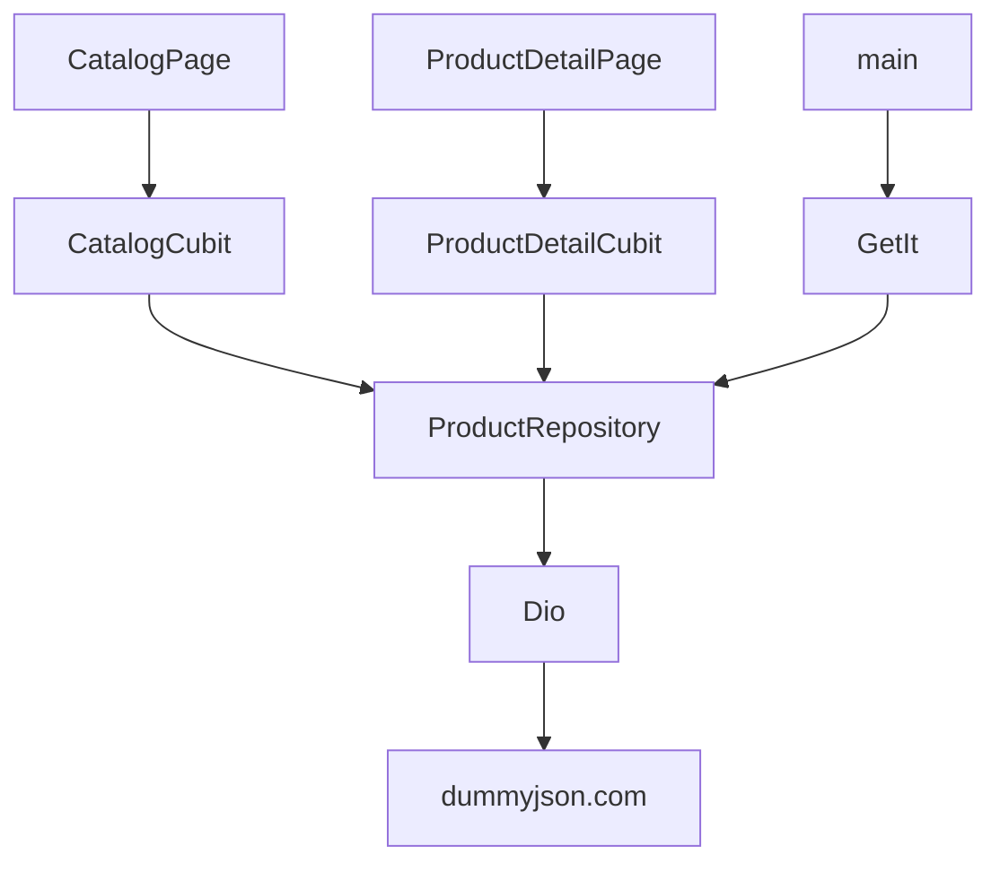

# API Explorer

API Explorer loads products from the public [DummyJSON](https://dummyjson.com) API and shows how a Flutter app should behave when the network is slow, empty, or wrong.

There is no API key. The app is not deployed.

## Problem

A list screen that only handles the happy path hides the code interviewers ask about: timeouts, HTTP status codes, bad JSON, and a second page that fails without wiping the first page.

## Features

- First page of products from `GET /products`
- Search via `GET /products/search`
- Pull to refresh
- Next page when the list is scrolled near the end
- Product detail from `GET /products/{id}`
- Timeouts of 8 seconds for connect, send, and receive
- Separate messages for timeout, offline, HTTP 404, HTTP 5xx, and JSON this app cannot read
- Retry on the full-page error
- A failed next page keeps the products already on screen
- Empty search result
- Thumbnail with an error placeholder

## Screenshots

Screenshots have not been captured. The live API was checked with HTTP requests on 12 October 2026: `/products?limit=1`, `/products/search?q=phone&limit=2`, and `/products/1` each returned HTTP 200. The widget tests do not call the network.

## Architecture



`CatalogCubit` owns the list, the query, and a generation counter. A newer search ignores a slower response from the previous search. `loadMore` failure returns a message and does not clear `products`.

GetIt is only the composition root in `lib/injection.dart`. Tests pass a fake repository into `ApiExplorerApp`.

Logs include the HTTP method, path, and status code or Dio error type. They do not include headers, bodies, or query strings.

## Folder structure

```text
lib/
  main.dart
  injection.dart
  app.dart
  data/dio_product_repository.dart
  data/api_failure_mapper.dart
  domain/product.dart
  domain/product_repository.dart
  presentation/catalog_cubit.dart
  presentation/catalog_page.dart
  presentation/detail_cubit.dart
  presentation/detail_page.dart
test/
```

## Stack

| Choice | Why |
| --- | --- |
| DummyJSON | Public, no key, stable list and search during the check on 12 October 2026. |
| Dio | Timeouts and `DioException.type` are explicit. |
| Cubit | List loading and detail loading are separate short lifecycles. |
| Scripted `HttpClientAdapter` | Repository tests do not need the network. |

## Setup

Flutter 3.44.9 and Dart 3.12.2.

```bash
flutter pub get
flutter run
```

The base URL is `https://dummyjson.com` in `createCatalogDio`. There is no `.env` file. To point tests at a fake, pass another `HttpClientAdapter` or implement `ProductRepository`.

## Testing

Verified locally on 12 October 2026 with Flutter 3.44.9:

- `flutter analyze` — no issues
- `flutter test` — 8 tests passed

The automated tests never call DummyJSON. CI has not run on GitHub yet. Coverage was not measured.

```bash
dart format --output=none --set-exit-if-changed .
flutter analyze
flutter test
```

## Known limitations

- Search runs when you submit the field or press the search button. It does not debounce each keystroke.
- Images use `Image.network` with no disk cache.
- The detail route creates its own cubit. It does not share the list cache, so opening a product hits the API again.
- The app has not been run on a device, so screenshots are absent.
- DummyJSON can change or go offline. The repository tests would still pass. The running app would show the mapped error.

## Future improvements

- Cache the detail response that is already in the list
- Debounce search
- Capture screenshots from a device session that actually loads DummyJSON
- Add a contract test that is allowed to hit the network and is not part of the default `flutter test` run

## Interview notes

See [INTERVIEW_GUIDE.md](INTERVIEW_GUIDE.md).

## License

[MIT](LICENSE) © 2026 Shubham Tomar

## Links

- Author: Shubham Tomar — shubhamtomarr68@gmail.com
- API: https://dummyjson.com
- GitHub: https://github.com/shubhamtomarr68-hub/flutter-api-explorer
